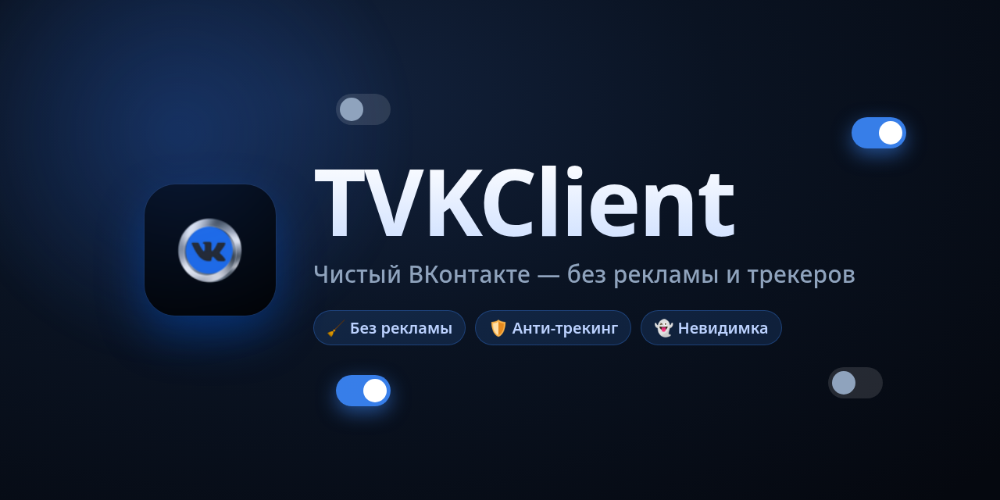
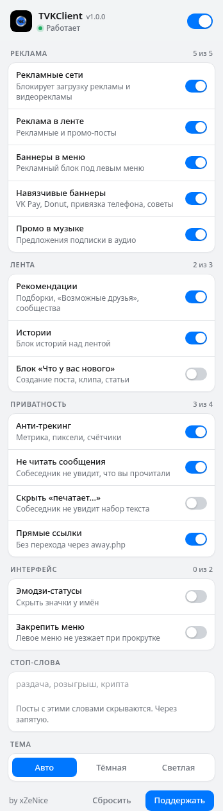
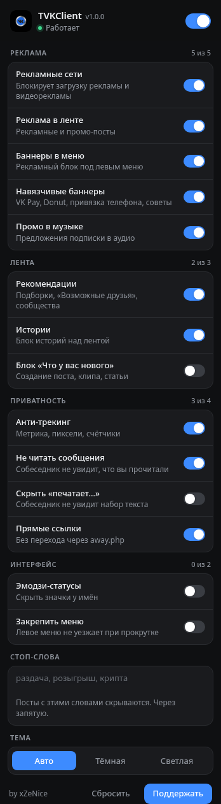

  

  <b>Расширение для браузера, которое вычищает ВКонтакте: реклама, рекомендации, трекеры, режим невидимки.</b>

  
  
  

---

## 📥 Установка

1. Нажми **Code → Download ZIP** и распакуй архив.
2. Открой `chrome://extensions`.
3. Включи **Режим разработчика** (переключатель справа сверху).
4. Нажми **Загрузить распакованное** и выбери папку с файлом `manifest.json`.
5. Открой любую страницу ВКонтакте и нажми на иконку расширения.

> Нужен Chrome, Edge, Opera или другой браузер на Chromium версии **111+**.

---

## ✨ Что умеет

Все функции включаются и выключаются по отдельности. Сверху есть общий выключатель — ставит всё на паузу одним кликом.

### 🧹 Реклама

| Функция | Что делает |
|---|---|
| **Рекламные сети** | Блокирует сами запросы к рекламным серверам (adfox, mytarget, Google Ads, Яндекс и др.). Отсюда пропадает **видео- и аудиореклама** — она просто не загружается. |
| **Реклама в ленте** | Скрывает рекламные и промо-посты по пометке «Реклама». |
| **Баннеры в меню** | Убирает рекламный блок под левым меню. |
| **Навязчивые баннеры** | Прячет баннеры VK Pay, VK Donut, предложение привязать телефон и «советы» сообществ. |
| **Промо в музыке** | Убирает предложения подписки и промо-блоки в разделе музыки. |

### 📰 Лента

| Функция | Что делает |
|---|---|
| **Рекомендации** | Скрывает «Возможные друзья», подборки сообществ и рекомендованные записи. |
| **Истории** | Убирает блок историй над лентой. |
| **Блок «Что у вас нового»** | Прячет панель создания поста, клипа и статьи. |

### 🔒 Приватность

| Функция | Что делает |
|---|---|
| **Анти-трекинг** | Блокирует метрику, пиксели и счётчики (Яндекс.Метрика, Mail.ru, Google Analytics и др.). |
| **Не читать сообщения** | Собеседник не увидит, что вы прочитали сообщение — отметка «прочитано» не отправляется. |
| **Скрыть «печатает…»** | Собеседник не увидит, что вы набираете текст. |
| **Прямые ссылки** | Внешние ссылки открываются напрямую, без редиректа через `away.php`. |

### 🎨 Интерфейс

| Функция | Что делает |
|---|---|
| **Эмодзи-статусы** | Скрывает значки-статусы рядом с именами. |
| **Закрепить меню** | Левое меню не уезжает вверх при прокрутке. |

### 🔇 Стоп-слова

Введите слова через запятую — посты с ними будут скрываться из ленты. Например: `раздача, розыгрыш, крипта`.

### 🌗 Тема

Авто, тёмная или светлая. В режиме «Авто» попап подстраивается под тему браузера и устройства.

---

## 🖼 Скриншоты

  
  &nbsp;&nbsp;
  

<i>Светлая и тёмная тема переключаются автоматически вслед за браузером.</i>

---

## ❓ Частые вопросы

**Какая-то реклама просочилась.**
ВКонтакте регулярно меняет вёрстку, и часть правил может устаревать. Открой [Issues](../../issues) и приложи скриншот — поправим.

**Тёмная тема не включается.**
В разделе «Тема» внизу попапа можно выбрать вручную: Авто, Тёмная или Светлая. «Авто» следует теме браузера и устройства.

---

## 💙 Поддержать

Проект бесплатный и с открытым кодом — форки и правки приветствуются. Если он вам полезен — [можно поддержать автора](https://finance.ozon.ru/apps/sbp/ozonbankpay/019b2417-8720-7b4b-a781-fc891511fdad).

**Автор:** xZeNice

---

TVKClient не связан с ВКонтакте и VK. Все названия принадлежат их владельцам.

